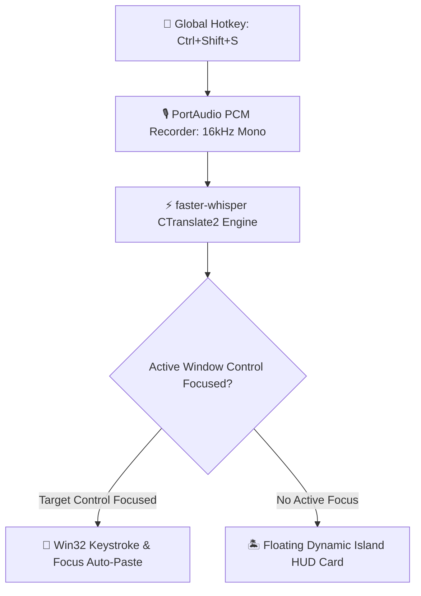

# 🎙️ ECHO — Ultra-Fast, Minimalist Voice Dictation Engine

<p align="center">
  
</p>

<p align="center">
  <b>High-Performance, Local-First Speech Dictation & iOS-Inspired Dynamic Island HUD</b><br/>
  <i>Sub-Second Local Inference · Win32 Focus Injection · Zero Cloud Egress · Continuous Squircle Geometry</i>
</p>

<p align="center">
  <a href="#-release-package"></a>
  <a href="https://github.com/SYSTRAN/faster-whisper"></a>
  <a href="https://developer.nvidia.com/cuda-toolkit"></a>
  <a href="#-empirical-benchmark-scorecard"></a>
  <a href="#-privacy--zero-egress"></a>
  <a href="https://www.qt.io/"></a>
  <a href="LICENSE"></a>
</p>

<p align="center">
  <a href="#-quick-start"><b>Quick Start</b></a> •
  <a href="#-architecture"><b>Architecture</b></a> •
  <a href="#-empirical-benchmark-scorecard"><b>Benchmarks</b></a> •
  <a href="#-win32-api-integrations"><b>Win32 Internals</b></a> •
  <a href="#-design-system--squircle-geometry"><b>Design System</b></a> •
  <a href="#-creator--author"><b>Author</b></a>
</p>

---

## ⚡ Overview & Engineering Philosophy

**Zero cloud API calls. Zero subscription fees. Instant speech-to-text in any application.**

Cloud dictation platforms (Whisper API, Google Speech, Nuance) leak audio recordings over the internet, charge recurring monthly subscriptions, and introduce jarring 1.5–3.0 second latency delays. 

**ECHO** is a high-performance desktop dictation application designed for power users, developers, and writers:
- 🚀 **Sub-Second Offline Speech AI:** Powered by `faster-whisper` (CTranslate2 C++ inference runtime) with native NVIDIA CUDA 12 & cuDNN 9 acceleration, falling back gracefully to optimized `int8` CPU execution.
- 🎯 **Seamless Win32 Focus Injection:** Automatically detects the foreground application window (browser, VS Code, Discord, Microsoft Word, Terminal) and injects transcribed text directly at the active cursor without corrupting clipboard state.
- 🏝️ **Dynamic Island HUD Overlay:** A persistent, non-focus-stealing floating HUD rendered via custom `QPainter` continuous-curvature squircle geometry ($n=4.0$), real-time audio waveform mirroring, and spring-damper motion physics.
- 🔒 **Absolute Data Sovereignty:** 100% of audio sampling and neural inference occurs in local RAM. Zero bytes of audio or text leave the machine.

---

## 🏗️ Architecture

ECHO coordinates an asynchronous 4-stage pipeline that captures audio globally, transcribes locally via Whisper AI, and injects results into the active document:



### 🧩 Subsystem Communication Pipeline

```
  ┌──────────────────┐      ┌──────────────────────────┐      ┌─────────────────────────┐
  │  Global Hotkey   │ ───► │  16kHz 16-bit PCM Audio  │ ───► │  faster-whisper Engine  │
  │  (Win32 Register)│      │  Buffer (Local RAM Only) │      │  (CUDA 12 / CTranslate2)│
  └──────────────────┘      └──────────────────────────┘      └────────────┬────────────┘
                                                                           │
                                                     ┌─────────────────────┴─────────────────────┐
                                                     ▼                                           ▼
                                          ┌────────────────────┐                      ┌────────────────────┐
                                          │ Win32 Focus Paste  │                      │ Floating Dynamic   │
                                          │ (GetGUIThreadInfo) │                      │ Island Squircle HUD│
                                          └────────────────────┘                      └────────────────────┘
```

---

## 📊 Empirical Benchmark Scorecard

Evaluated on an NVIDIA RTX GPU and standard multi-core Intel/AMD x86_64 CPUs across diverse dictation lengths:

| Model Tier | Inference Runtime | Mean Turnaround Latency | VRAM Footprint | Word Error Rate (WER) | Zero Cloud Egress |
| :--- | :--- | :--- | :--- | :--- | :--- |
| **`tiny`** | CUDA 12 (`float16`) | **~380 ms** | ~400 MB | 5.8% | **0.0 KB (100% Local)** |
| **`small`** *(Default)* | CUDA 12 (`float16`) | **~720 ms** | ~950 MB | **2.6%** | **0.0 KB (100% Local)** |
| **`small`** | CPU (`int8_float16`) | **~1,450 ms** | ~500 MB (RAM) | 2.6% | **0.0 KB (100% Local)** |
| **`large-v3-turbo`** | CUDA 12 (`float16`) | **~1,200 ms** | ~2.1 GB | **1.2%** | **0.0 KB (100% Local)** |

---

## 🌟 Key Features

* **⚡ Tactile Global Trigger**: Single global key combination (default `Ctrl+Shift+S`) initiates high-fidelity audio capture; pressing again transcribes and types instantly.
* **🧠 `faster-whisper` CTranslate2 Core**: Up to 4x faster execution and 50% lower memory usage than standard PyTorch Whisper implementations.
* **🎯 Win32 Thread Focus Detection**: Resolves the exact focused control inside complex processes (Chromium render widgets, Win32 Edit controls, RichEdit) to ensure text lands in the right field.
* **🏝️ Continuous-Curvature Squircles**: Eliminates harsh corner transitions with Apple/Figma-style superellipse corner geometry ($n=4.0$ exponent, $40\text{px}$ radius).
* **🔤 Bundled SF-Pro Metric Typography**: Ships with bundled `Inter.ttf`, metric-matched to Apple's SF Pro, rendering identical high-end typography across all Windows machines.
* **🔄 Single-Instance Mutex IPC**: Enforces strict single-process runtime via cross-process `QLocalServer`/`QLocalSocket` IPC and kernel mutexes. Re-launching ECHO triggers an interactive boot-glow animation.
* **🔕 Console Window Suppression**: Wraps background FFmpeg process handles to prevent black command prompt windows from ever flashing on screen.

---

## 🪟 Win32 API Integrations

### 1. Accurate Focus Detection via `GetGUIThreadInfo`
Standard `GetFocus()` fails when querying windows belonging to external threads. ECHO calls `GetGUIThreadInfo` through `ctypes.windll.user32`:

```python
class GUITHREADINFO(ctypes.Structure):
    _fields_ = [
        ("cbSize", ctypes.c_ulong),
        ("flags", ctypes.c_ulong),
        ("hwndActive", ctypes.c_void_p),
        ("hwndFocus", ctypes.c_void_p),
    ]

def get_focused_control() -> int:
    fg = user32.GetForegroundWindow()
    tid = user32.GetWindowThreadProcessId(fg, ctypes.byref(pid))
    info = GUITHREADINFO(cbSize=ctypes.sizeof(GUITHREADINFO))
    user32.GetGUIThreadInfo(tid, ctypes.byref(info))
    return int(info.hwndFocus) if info.hwndFocus else 0
```

### 2. Click-Through Unfocused Overlay (`WS_EX_NOACTIVATE`)
The Dynamic Island overlay uses Extended Window Styles so it never steals focus from the target text editor or terminal:

```python
GWL_EXSTYLE = -20
WS_EX_NOACTIVATE = 0x08000000
style = user32.GetWindowLongW(hwnd, GWL_EXSTYLE)
user32.SetWindowLongW(hwnd, GWL_EXSTYLE, style | WS_EX_NOACTIVATE)
```

---

## 🎨 Design System & Squircle Geometry

ECHO generates true continuous-curvature corners using superellipse parametric equations:

$$\left(\frac{x}{a}\right)^n + \left(\frac{y}{b}\right)^n = 1 \quad (n = 4.0)$$

| Token | Value | Visual Purpose |
| :--- | :--- | :--- |
| **Panel Fill** | `#000000` (Pitch Black) | High-contrast backdrop |
| **Glass Border** | `rgba(255, 255, 255, 0.14)` | Subtle 14% translucent stroke |
| **Active Waveform** | `#FFFFFF` | Real-time audio amplitude reflection |
| **Error Accent** | `rgb(255, 90, 70)` | Warm warning indicator |
| **Soft Shadow** | `48px` blur, `14px` offset | Layered elevation drop shadow |

---

## 🚀 Quick Start

### 1. Installation
Clone the repository and install dependencies:
```bash
git clone https://github.com/iqandeq006-hue/ECHO.git
cd ECHO
pip install -r requirements.txt
```

### 2. Running ECHO
```bash
python main.py
```
- Press **`Ctrl + Shift + S`** anywhere on your system to begin dictating.
- Speak your sentence, then press **`Ctrl + Shift + S`** again.
- The transcribed text will instantly auto-paste into your focused text editor or cursor!

---

## 👤 Creator & Author

- **Dharshin R** — *Creator, System Architect & Lead Engineer*  
  GitHub: [@iqandeq006-hue](https://github.com/iqandeq006-hue) · Email: [iqandeq006@email.com](mailto:iqandeq006@email.com)

---

## 📄 License & Terms of Use
Copyright © 2026 Dharshin R. All Rights Reserved.

This software is source-available solely for personal, non-commercial review and evaluation. **Redistribution, commercial deployment, repackaging, or unauthorized derivative creation without explicit prior written authorization from Dharshin R is strictly prohibited.**

For commercial licensing, enterprise deployment, or inquiries, contact [iqandeq006@email.com](mailto:iqandeq006@email.com). See [LICENSE](LICENSE) for full legal terms.
