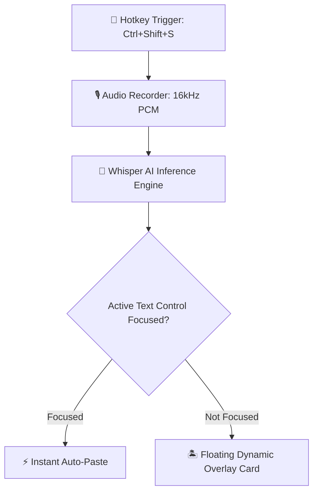

# 🎙️ ECHO — Ultra-Fast, Minimalist Voice Dictation Engine

<p align="center">
  <b>ECHO</b> is an open-source, high-performance desktop speech-to-text dictation application. Powered by Python, PyQt5, and <code>faster-whisper</code> (CTranslate2), it combines an iOS Dynamic Island-inspired overlay, continuous-curvature squircle geometry, offline CUDA GPU acceleration, and focus detection for instant auto-pasting into any application.
</p>

<p align="center">
  <a href="#-architecture">Architecture</a> •
  <a href="#-key-features">Key Features</a> •
  <a href="#-win32-api-integrations">Platform Details</a> •
  <a href="#-design-system--squircle-geometry">Design System</a> •
  <a href="#-project-structure">Project Structure</a> •
  <a href="#-windows-deployment--packaging">Deployment</a> •
  <a href="#-getting-started">Getting Started</a> •
  <a href="#-license">License</a>
</p>

---

## 🏗️ Architecture

ECHO uses a streamlined 4-stage pipeline that captures audio globally, transcribes it locally via Whisper AI, and delivers the result instantly to your active text field or floating overlay.



### 🧩 System Flow

```
  ┌──────────────────┐      ┌──────────────────┐      ┌──────────────────┐
  │  Global Hotkey   │ ───► │  Audio Recorder  │ ───► │ Whisper AI Engine│
  │ (Toggle Switch)  │      │  (16kHz PCM Wav) │      │  (Local Model)   │
  └──────────────────┘      └──────────────────┘      └────────┬─────────┘
                                                               │
                                         ┌─────────────────────┴─────────────────────┐
                                         ▼                                           ▼
                              ┌────────────────────┐                      ┌────────────────────┐
                              │ Instant Auto-Paste │                      │ Floating Dynamic   │
                              │ (Focus Detection)  │                      │ Overlay HUD Card   │
                              └────────────────────┘                      └────────────────────┘
```

---

## 🌟 Key Features

* **⚡ Global Trigger Hotkey**: Press a customizable global shortcut (default `Ctrl+Shift+S`) anywhere in your system to start recording, and press again to stop and transcribe seamlessly.
* **🧠 Offline Whisper AI Engine**: Powered by `faster-whisper` (CTranslate2 C++ inference runtime). 100% private, local, and offline.
* **🚀 CUDA GPU Acceleration + CPU Fallback**: Automatically harnesses NVIDIA CUDA 12 & cuDNN 9 DLLs if installed, with seamless fallback to optimized `int8` CPU quantization on standard hardware.
* **🎯 Focus Auto-Pasting**: Identifies active input controls (browsers, text editors, IDEs, Discord, Office) and auto-pastes transcribed text directly into the focused field.
* **🏝️ Dynamic Island Floating Overlay**: Custom `QPainter` HUD window floating above the system taskbar with spring-based motion curves (`OutBack` overshoot), audio waveform mirroring, spinning loading arcs, and transcript cards.
* **🔲 Continuous-Curvature Squircles**: Implements iOS/Figma-style superellipse geometry ($n=4.0$ exponent, $40\text{px}$ corner radius) with layered soft drop shadows.
* **🔤 Bundled Inter Variable Typography**: Ships with bundled `Inter.ttf`, metric-matched to Apple's SF Pro, ensuring identical high-end typography across all machines.
* **🔄 Smart Single-Instance IPC**: Prevents duplicate instances via cross-process `QLocalServer`/`QLocalSocket` IPC and kernel mutexes. Re-launching ECHO signals the running background instance to trigger a boot glow animation.
* **🔕 Suppressed Console Windows**: Custom subprocess wrapper prevents background FFmpeg audio decoding from flashing black command prompt windows on screen.
* **📜 History & Settings Panel**: Dedicated dark-mode settings panel with live model selection (`tiny` through `large-v3-turbo`), hotkey re-binding, sound cue toggles, and searchable history with one-click copying.

---

## 🪟 Platform & Win32 Integration Details

### 1. Focus Detection via `GetGUIThreadInfo` (`app.py`)

Standard `GetFocus()` fails across thread boundaries when querying windows belonging to other processes. ECHO calls `GetGUIThreadInfo` via `ctypes.windll.user32`:

```python
class GUITHREADINFO(ctypes.Structure):
    _fields_ = [
        ("cbSize", ctypes.c_ulong),
        ("flags", ctypes.c_ulong),
        ("hwndActive", ctypes.c_void_p),
        ("hwndFocus", ctypes.c_void_p),
        # ...
    ]

def get_focused_control() -> int:
    fg = user32.GetForegroundWindow()
    tid = user32.GetWindowThreadProcessId(fg, ctypes.byref(pid))
    info = GUITHREADINFO(cbSize=ctypes.sizeof(GUITHREADINFO))
    user32.GetGUIThreadInfo(tid, ctypes.byref(info))
    return int(info.hwndFocus) if info.hwndFocus else 0
```

ECHO inspects the window class name (`GetClassNameW`) to confirm editability before issuing `Ctrl+V` pastes:
* `Edit`, `RichEdit20W`, `TextBox`
* `Chrome_RenderWidgetHostHWND` (Chrome, Edge, Brave, Electron apps like VS Code / Discord)
* `Chrome_WidgetWin_1`

### 2. Click-Through Unfocused Overlay (`ui/overlay.py`)

The floating Dynamic Island overlay uses Extended Window Styles so it never steals keyboard focus from the active document:

```python
GWL_EXSTYLE = -20
WS_EX_NOACTIVATE = 0x08000000
style = user32.GetWindowLongW(hwnd, GWL_EXSTYLE)
user32.SetWindowLongW(hwnd, GWL_EXSTYLE, style | WS_EX_NOACTIVATE)
```

### 3. Taskbar Tracking & Topmost Assertion (`core/shell_watcher.py`)

ECHO tracks `Shell_TrayWnd` (the Windows Taskbar window) via Win32 `GetWindowRect` to dynamically anchor the floating HUD directly above the taskbar regardless of display scaling (100%–225%) or multi-monitor configurations:

```python
user32.SetWindowPos(
    hwnd, HWND_TOPMOST, 0, 0, 0, 0,
    SWP_NOMOVE | SWP_NOSIZE | SWP_NOACTIVATE
)
```

### 4. Non-Console Subprocess Patch (`main.py`)

Whisper internally shells out to `ffmpeg.exe` to parse audio. To prevent black command prompt windows from briefly flashing on Windows, `main.py` patches `subprocess.Popen`:

```python
if platform.system() == "Windows":
    _original_popen_init = subprocess.Popen.__init__
    def _patched_popen_init(self, *args, **kwargs):
        kwargs["creationflags"] = kwargs.get("creationflags", 0) | subprocess.CREATE_NO_WINDOW
        _original_popen_init(self, *args, **kwargs)
    subprocess.Popen.__init__ = _patched_popen_init
```

### 5. Non-Admin AppData Storage Path (`core/recorder.py`)

When installed to `C:\Program Files\ECHO\`, standard user accounts lack write permissions to the application directory. ECHO writes temporary PCM audio captures to user-writable AppData:

$$\text{\%APPDATA\%}\setminus\text{ECHO}\setminus\text{temp}\setminus\text{audio.wav}$$

---

## 🎨 Design System & Squircle Geometry

ECHO's design system is defined in `ui/glass.py`.

### 🔲 Squircle Math ($n=4.0$)

Standard CSS `border-radius` uses circular arcs, resulting in abrupt curvature transitions at tangent points. ECHO generates continuous-curvature corners using superellipse parametric equations:

$$\left(\frac{x}{a}\right)^n + \left(\frac{y}{b}\right)^n = 1$$

```python
def squircle_path(rect: QRectF, radius: float = 40.0, n: float = 4.0, samples: int = 20) -> QPainterPath:
    # Traces fixed-radius superellipse arcs at all 4 corners
    # and connects them with straight edges (iOS/Figma corner smoothing algorithm)
```

### 🎨 Color Palette & Tokens

| Token | Value | Description |
| :--- | :--- | :--- |
| **Background Fill** | `#000000` (Pure Pitch Black) | Deep black panel fill for crisp contrast |
| **Glass Border** | `rgba(255, 255, 255, 0.14)` | 14% translucent white stroke |
| **Primary Accent** | `#FFFFFF` | Crisp white typography and control fill |
| **Warning Accent** | `rgb(255, 90, 70)` | Warm red for errors and un-bound inputs |
| **Shadow Blur** | `48px` blur, `14px` offset | Layered soft drop-shadow rendering |

---

## 📁 Project Structure

```
ECHO/
├── main.py                  # Application entrypoint, CUDA pre-load & IPC server
├── app.py                   # Central App state machine & worker thread coordinator
├── requirements.txt         # Core dependencies (PyQt5, faster-whisper, etc.)
├── LICENSE                  # MIT License (Dharshin R)
│
├── assets/                  # Visual and acoustic assets
│   ├── fonts/
│   │   └── Inter.ttf        # Bundled Inter Variable font (San Francisco metric match)
│   ├── sounds/              # Audio cue WAV files (pop_record, success, no_speech, error)
│   ├── ECHO.ico / ECHO.png  # Application icons
│
├── config/                  # Configuration & Logging
│   ├── config.py            # JSON persistent configuration store
│   ├── config.json          # User settings (selected model, hotkey, sound toggle)
│   └── logging_config.py    # Console and file logger setup
│
├── core/                    # Core Engine Modules
│   ├── transcriber.py       # Faster-Whisper CTranslate2 wrapper with GPU/CPU fallback
│   ├── recorder.py          # Sounddevice PCM recording engine
│   ├── typer.py             # Focus-aware auto-paste & clipboard restoration
│   ├── hotkey.py            # Low-level global keyboard hotkey listener
│   ├── ipc.py               # QLocalServer / QLocalSocket single-instance IPC
│   ├── history.py           # Local JSON transcription history manager
│   ├── shell_watcher.py     # Taskbar tracker & HWND_TOPMOST assertion
│   ├── sound_cues.py        # Async sound cue playback engine
│   └── theme.py             # Windows registry light/dark mode reader
│
└── ui/                      # PyQt5 Graphical Interface
    ├── glass.py             # Design system, squircle_path math, easing curves & QSS
    ├── overlay.py           # Custom QPainter Dynamic Island HUD overlay widget
    ├── settings.py          # SquirclePanel settings window, model manager & history
    ├── fallback.py          # Paste fallback dialog window
    └── tray.py              # System tray menu icon
```

---

## 📦 Windows Deployment & Packaging

ECHO can be compiled into a standalone executable or packaged into a single setup installer.

### 1. PyInstaller Executable Build

To compile a standalone `ECHO.exe` bundle:

```bash
pyinstaller --noconfirm --onedir --windowed \
    --name "ECHO" \
    --icon "assets/ECHO.ico" \
    --add-data "assets;assets" \
    --add-data "models;models" \
    main.py
```

* **FFmpeg Bundling**: Prepend `ffmpeg.exe` to `dist/ECHO/` so Whisper can decode audio without requiring a separate system-wide FFmpeg installation.

### 2. Inno Setup Windows Installer

Use Inno Setup (`echo.iss`) to package `dist/ECHO/` into an installer (`ECHO_Setup_v1.0.0.exe`):
* Creates Start Menu & Desktop shortcuts.
* Configures Windows Startup registry key (`HKCU\Software\Microsoft\Windows\CurrentVersion\Run`) for auto-launching on boot.
* Writes uninstaller to Control Panel.

---

## 🚀 Getting Started

### Prerequisites

* **OS**: Windows 10 or Windows 11 (64-bit)
* **Python**: Python 3.10, 3.11, or 3.12
* **FFmpeg**: Bundled with executable releases or available on system `PATH`
* **GPU (Optional)**: NVIDIA GPU with CUDA 12 and cuDNN 9 for fastest inference

### Developer Installation

1. **Clone the repository**:
   ```cmd
   git clone https://github.com/your-repo/echo.git
   cd echo
   ```

2. **Create a virtual environment**:
   ```cmd
   python -m venv echo
   call echo\Scripts\activate
   ```

3. **Install dependencies**:
   ```cmd
   pip install -r requirements.txt
   ```

4. **Run ECHO**:
   ```cmd
   python main.py
   ```

---

## ⚙️ Configuration & Settings

Configuration is stored in `config/config.json`.

```json
{
  "model": "tiny",
  "hotkey": "ctrl+shift+s",
  "sound_enabled": true
}
```

### Supported Whisper Models

| Model Name | Size | Speed | Best For |
| :--- | :--- | :--- | :--- |
| `tiny` / `tiny.en` | ~75 MB | ⚡ Ultra-fast | Low-power CPUs, fast voice commands |
| `base` / `base.en` | ~145 MB | 🚀 Very fast | General dictation |
| `small` / `small.en` | ~460 MB | ⚖️ Balanced | High accuracy dictation |
| `medium` / `medium.en` | ~1.5 GB | 🎯 High accuracy | Technical vocabulary |
| `large-v3-turbo` / `turbo` | ~1.6 GB | ⚡ Optimized Large | Maximum accuracy with low latency |

---

## 📄 License

This project is open-source under the [MIT License](LICENSE).

**Copyright (c) 2026 Dharshin R**
